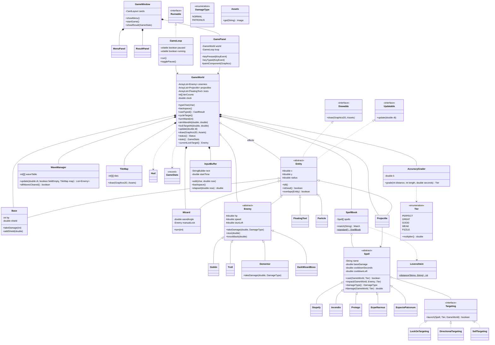

# DESIGN: Spell Defender

เอกสารออกแบบสถาปัตยกรรมที่อนุมัติแล้ว (11 ต.ค. 2026) ใช้คู่กับ `SPEC.md`: SPEC บอกว่าเกมต้อง**ทำอะไร** ส่วนเอกสารนี้บอกว่าโค้ด**จัดโครงอย่างไร**
ถ้าตอนเขียนโค้ดต้องเบี่ยงจากเอกสารนี้ ให้แก้เอกสารก่อน แล้วค่อยแก้โค้ด

## 1. ภาพรวม

เปรียบเกมเป็นร้านอาหาร:
- **`GameWorld` = ห้องครัว** ข้อมูลและกฎทั้งหมดของเกมอยู่ที่นี่ (ศัตรู คาถา HP ฐาน wave)
- **Swing = พนักงานหน้าร้าน** มีหน้าที่แค่รับปุ่มที่กดแล้วส่งต่อให้ `GameWorld` และสั่งวาดจอ ห้ามแก้ข้อมูลเกมเอง
- **`GameLoop` = นาฬิกาของครัว** มี thread เดียว ทุก ~1/60 วินาทีจะเรียก `world.update(dt)` แล้วตามด้วย `panel.repaint()`

ข้อดี: ห้องครัวไม่ต้องมีหน้าจอ จึงทดสอบด้วย JUnit ได้โดยไม่ต้องเปิดเกม

## 2. Package

แบ่งเป็น 3 package และ dependency ชี้ไปทางเดียว ห้ามย้อนกลับ:

```
ui  ──▶  model  ──▶  typing
```

| Package | มีอะไร | กฎ |
|---|---|---|
| `spelldefender.typing` | `Levenshtein`, `Tier`, `AccuracyGrader`, `InputBuffer` | ใช้แค่ JDK เป็น logic ล้วน |
| `spelldefender.model` | `GameWorld`, entity ทุกตัว, คาถา, การเล็ง, `WaveManager`, `TileMap`, `Hud`, `Assets`, `GameStats` | ใช้ `java.awt` ได้ (Graphics2D, Color) แต่**ห้าม import `javax.swing`** · ทุก class ยกเว้น `GameWorld` / `GameStats` / `Assets` เป็น package-private |
| `spelldefender.ui` | `GameWindow`, `MenuPanel`, `GamePanel`, `ResultPanel`, `GameLoop` | Swing อยู่ที่นี่ที่เดียว และคุยกับ model ผ่าน `GameWorld` เท่านั้น |
| `spelldefender` | `Main` | เปิดหน้าต่างผ่าน `SwingUtilities.invokeLater` |

ที่ `model` เป็น package เดียวแบน ๆ ก็เพราะ package-private ทำให้ compiler ไม่ยอมให้ `ui` เรียกของภายในตรง ๆ

## 3. Thread และ `synchronized`

มีงานสองฝั่งที่แตะ list ศัตรูพร้อมกัน คือ game thread (ขยับและลบศัตรู) กับ Swing EDT (วาดจอและรับปุ่ม)

**กฎข้อเดียว:** public method **ทุกตัว**ของ `GameWorld` เป็น `synchronized` ใครจะเข้า GameWorld ต้องถือกุญแจ และเข้าได้ทีละคน

กฎย่อยที่ตามมา:
- **ลบทีหลัง:** ระหว่าง `update` entity แค่เรียก `kill()` ตัวเอง แล้วตอนท้าย `update` มีจุดเดียวที่ลบด้วย `removeIf` จึงไม่มีการลบออกจาก list ระหว่างวน loop
- **ห้ามเรียก Swing ระหว่างถือกุญแจ:** ตอนเกมจบ `GameLoop` จะเอา `world.stats()` ออกมาก่อน แล้วค่อยเรียก `SwingUtilities.invokeLater(...)` เพื่อเปลี่ยนไปหน้า Result
- **Pause:** ใช้ `volatile boolean paused` ใน `GameLoop` ห้ามใช้ `Thread.suspend()`
- **dt:** วัดด้วย `System.nanoTime()` และจำกัดค่าสูงสุด (`MAX_DT`) เพื่อไม่ให้เกมกระโดดหลังเครื่องค้าง · การเคลื่อนที่ใช้ `pos += speed * dt`
- **เวลาในเกม:** `GameWorld.clock` คือผลรวมของ `dt` และใช้กับทุกอย่าง (cooldown, parTime) ตอน pause จึงไม่นับเวลาพิมพ์ และเทสต์ไม่ต้องรอเวลาจริง
- **Focus:** หลังสลับ card ต้องเรียก `gamePanel.requestFocusInWindow()` และใน constructor ของ `GamePanel` ต้องเรียก `setFocusTraversalKeysEnabled(false)` ไม่อย่างนั้น Swing จะกิน Tab ไปใช้ย้าย focus

## 4. Public API ของ `GameWorld` (ทั้งหมดที่ `ui` เรียกได้)

```java
public GameWorld(long seed)                         // เกมใหม่ 1 เกม · Restart = new GameWorld (ไม่มี reset())
public synchronized void typeChar(char c)           // EDT: a–z / space (ตัวอื่นไม่รับ)
public synchronized void backspace()                // EDT
public synchronized CastResult castTyped()          // EDT: Enter ทำทั้ง pipeline
public synchronized void cycleTarget()              // EDT: Tab
public synchronized void turnWand(int direction)    // EDT: ← = -1, → = +1 (ยังใช้ได้ แต่หลักคือเมาส์)
public synchronized void aimWandAt(double x, double y)   // EDT: ขยับเมาส์ = หันไม้
public synchronized void lockTargetAt(double x, double y) // EDT: คลิก = ล็อกศัตรูที่ใกล้จุดคลิก
public synchronized void update(double dt)          // game thread
public synchronized void draw(Graphics2D g, Assets assets) // EDT: paintComponent
public synchronized Status status()                 // PLAYING / WON / LOST
public synchronized GameStats stats()               // record ที่แก้ไม่ได้ ใช้ในหน้า Result
```

ตัวอย่างการเรียกจาก `GamePanel`:

```java
public void keyPressed(KeyEvent e) {
    if (e.getKeyCode() == VK_ESCAPE) { loop.togglePause(); repaint(); return; }
    if (loop.isPaused()) return;
    switch (e.getKeyCode()) {
        case VK_ENTER      -> world.castTyped();
        case VK_BACK_SPACE -> world.backspace();
        case VK_TAB        -> world.cycleTarget();
        case VK_LEFT       -> world.turnWand(-1);
        case VK_RIGHT      -> world.turnWand(+1);
    }
}
public void keyTyped(KeyEvent e) { world.typeChar(e.getKeyChar()); }
protected void paintComponent(Graphics g) { super.paintComponent(g); world.draw((Graphics2D) g, assets); }
```

## 5. ขั้นตอนการร่ายคาถา (`castTyped()` ที่เดียว)

ตัวอย่าง: ผู้เล่นพิมพ์ `stupify` แล้วกด Enter

1. **`InputBuffer`** ให้ข้อความที่พิมพ์ และเวลาที่ใช้ (นับจากกดตัวแรก ตามนาฬิกาในเกม) แล้วล้าง buffer
2. **`SpellBook.match`** ใช้ `Levenshtein.distance` เทียบกับทุกคาถา เลือกอันที่ distance ต่ำสุด ถ้าเสมอกันเลือกอันที่สั้นกว่า → Stupefy, distance 1
3. ถ้าคาถายังติด cooldown: ขึ้น "Cooldown!" แล้วจบ (`ON_COOLDOWN`)
4. **`AccuracyGrader.grade(distance, length, seconds)`** คืน `Tier`
   - `accuracy = 1 - distance / length`
   - PERFECT เมื่อ distance == 0 **และ** seconds ≤ `parTime = length × k + 1`
   - ระดับอื่นตัดตามค่า accuracy ที่เก็บไว้ใน `Tier`
5. **`spell.cast(world, tier)`** เช็ก cooldown แล้วให้ `Targeting` หาเป้าและยิง ถ้าหาเป้าไม่เจอ (ไม่มีศัตรู) คืน `false` ซึ่งนับเป็น FIZZLE
6. บันทึกสถิติ (`int[] tierCounts`) และแสดงข้อความลอย เช่น "Great!"

ตอน projectile ชนเป้า `GameWorld` จะเรียก `spell.impact(world, hit, tier)` ซึ่งแต่ละคาถา override เอง

### ค่าเริ่มต้นที่ตกลงแล้ว (ปรับได้ตอน playtest ใน M2–M3)

| เรื่อง | ค่า |
|---|---|
| `k` ใน parTime | 0.25 s ต่อตัวอักษร |
| ค่าตัด accuracy | Great ≥ 0.85 · Good ≥ 0.60 · Weak ≥ 0.30 · ต่ำกว่านั้นเป็น Fizzle |
| Backspace | ไม่ทำให้เสียสิทธิ์ PERFECT (ดูแค่ distance สุดท้ายกับเวลา) |
| Fizzle | ไม่เริ่มนับ cooldown |
| เป้า lock-on ตายระหว่างที่ projectile ยังบินอยู่ | หาเป้าใหม่ที่ใกล้ที่สุด ถ้าไม่มีศัตรูเหลือ projectile หายไป |
| เล็ง | ไม้กายสิทธิ์หันตามเมาส์ (จำกัด ±75°) · คลิกศัตรูเพื่อล็อกเป้า · ←/→ ยังใช้ได้ |
| Combo | PERFECT ติดกัน: ครั้งที่ 2 ได้ดาเมจ +10% เพิ่มครั้งละ 10% สูงสุด +50% · ได้ระดับอื่นเมื่อไหร่ Combo กลับเป็น 0 · `GameWorld` เป็นเจ้าของ `combo`, `Spell.damage(world, tier)` อ่าน `world.comboMultiplier()` |
| เอฟเฟกต์ | `Particle` (เศษประกาย) และ `FloatingText` (ตัวเลขดาเมจ, Tier, Combo) อยู่ใน `ArrayList<Entity> effects` ตัวเดียว · จอสั่นเมื่อฐานโดนตี |
| ขนาดหน้าต่าง / tile | 960×640, tile 32px |

## 6. Class diagram



## 7. แต่ละเรื่องมีเจ้าของคนเดียว

| ข้อมูล / กฎ | เจ้าของ | คนอื่นทำได้แค่ |
|---|---|---|
| ข้อความที่พิมพ์ + เวลาเริ่มพิมพ์ | `InputBuffer` | `GameWorld` ส่งค่า `clock` เข้าไปให้ |
| ตัวคูณและค่าตัดของแต่ละระดับ | `Tier` | `AccuracyGrader` คำนวณแค่ parTime |
| cooldown | `Spell` แต่ละอัน (เริ่มนับเมื่อร่ายออกจริงเท่านั้น) | HUD อ่าน `cooldownFraction()` |
| ทิศไม้กายสิทธิ์ + เป้าที่ล็อกด้วย Tab | `Wizard` | |
| "ตอนนี้เล็งตัวไหน" | `GameWorld.currentLockTarget()` | ถ้าเป้าที่ล็อกไว้ยังไม่ตาย ใช้ตัวนั้น ไม่อย่างนั้นใช้ตัวที่ใกล้ฐานที่สุด ถ้าไม่มีเลยคืน `null` (= Fizzle) · ทั้ง marker บนจอและตอนร่ายเรียกที่นี่ |
| Dementor ทนทุกคาถายกเว้น Patronum | `Dementor.takeDamage` เท่านั้น | คาถาแค่บอก `damageType()` (`ExpectoPatronum` override ให้คืน `PATRONUS`) |
| HP + โล่ของฐาน | `Base` | Protego เรียก `addShield`, ศัตรูที่ถึงฐานเรียก `takeDamage` |
| จำนวนศัตรูแต่ละ wave | `WaveManager.int[][] waveTable` (แถว = wave, คอลัมน์ = Goblin/Troll/Dementor/Boss) | constructor ไม่รับตารางที่ความกว้างผิด |
| รายการคาถาทั้งหมด | `SpellBook.standard()` | การ match, HUD และหน้า How to play วนจาก list นี้ |

## 8. หัวข้อที่เรียน → class ที่ใช้ (ใช้ในรายงานและสไลด์)

| หัวข้อ | ใช้ที่ไหน |
|---|---|
| Class/Object | ทุก entity, `SpellBook`, `InputBuffer`, `Tier` (enum ที่มี field) |
| Method | `Levenshtein.distance`, `SpellBook.match`, `AccuracyGrader.grade` |
| Array | `Spell[]` ใน `SpellBook`, `int[] tierCounts` |
| 2D array | `int[][] dp` ใน `Levenshtein`, `int[][] waveTable`, `int[][] tiles` |
| ArrayList | `enemies`, `projectiles`, `texts` ใน `GameWorld` |
| Inheritance | `Entity → Enemy → Goblin/Troll/Dementor/DarkWizardBoss`, `Spell → 5 คาถา` |
| Polymorphism | `enemy.takeDamage(...)` (Dementor override), `spell.impact(...)`, `entity.draw(...)` วน loop เดียว, `effects` list ที่มีทั้ง `FloatingText` และ `Particle` |
| Interface/Abstract | `Updatable`, `Drawable`, `Targeting` · `abstract Entity/Enemy/Spell` |
| GUI/Event | `GameWindow` (CardLayout), `MenuPanel`/`ResultPanel` (ActionListener), `GamePanel` (KeyListener + MouseListener/MouseMotionListener) |
| Graphics | `draw(Graphics2D)` ของแต่ละ entity, `TileMap`, `Hud`, `Assets` (BufferedImage) |
| Thread | `GameLoop implements Runnable`, `volatile`, `synchronized` ใน `GameWorld`, `invokeLater` |

## 9. Test (JUnit 5, เทสต์เฉพาะ model)

| Test class | ตรวจอะไร | Milestone |
|---|---|---|
| `LevenshteinTest` | `distance("incendio","incendoi") == 2`, string ว่าง | M1 |
| `AccuracyGraderTest` | ถูกหมดและเร็วได้ PERFECT, ถูกหมดแต่ช้าได้ GREAT, ค่าที่อยู่บนเส้นตัดของแต่ละ Tier | M1 |
| `SpellBookTest` | `match("stupify")` ได้ Stupefy, distance เสมอกันเลือกคาถาที่สั้นกว่า, `"xyz"` ได้ Fizzle, input ว่างไม่ crash | M1 |
| `GameWorldTest` | ร่ายซ้ำก่อน cooldown หมดไม่ออก, Dementor โดน patronum มากกว่า stupefy, เป้าตายแล้วเปลี่ยนเป้าเอง, ไม่มีศัตรูแล้วได้ Fizzle | M3 |
| `WaveManagerTest` | จำนวนที่ spawn ตรงกับ `waveTable`, boss ออกใน wave 5 | M4 |
| `ArchitectureTest` | ไฟล์ใน `model/` และ `typing/` ไม่มีการ import `javax.swing` | M0 |

เทสต์สร้าง world ด้วย constructor แบบ package-private ที่ให้เลือกส่วนประกอบเองได้:

```java
GameWorld w = new GameWorld(SpellBook.standard(), WaveManager.idle(), TileMap.standard());
w.addEnemy(new Dementor(600, 300));   // hook แบบ package-private สำหรับเทสต์
```

## 10. Milestones (อิงตาม SPEC §4)

| # | ช่วง | Class ที่สร้างหรือทำให้ใช้งานได้ | ถือว่าเสร็จเมื่อ |
|---|---|---|---|
| M0 | 11–12 ต.ค. | `Main`, `GameWindow` (JFrame เปล่า), `test.sh`/`run.sh`/`build.sh` (+ `.bat`), JUnit standalone jar, GitHub Actions, `ArchitectureTest` | `./test.sh` ผ่าน, `./run.sh` เปิดหน้าต่างได้, Actions เป็นสีเขียว |
| M1 | 13–15 ต.ค. | `Levenshtein`, `Tier`, `AccuracyGrader`, `InputBuffer`, `Spell` (แค่ constructor/getter), `SpellBook.match` | `LevenshteinTest`, `AccuracyGraderTest`, `SpellBookTest` ผ่าน (ยังไม่มีกราฟิก) |
| M2 | 16–18 ต.ค. | `GameLoop`, `GamePanel`, `GameWorld` (update/draw/castTyped), `Entity`, `Base`, `Wizard`, `Enemy`, `Goblin`, `Projectile`, `FloatingText`, `LockOnTargeting`, `Stupefy` | เล่นได้: Goblin เดินเข้าหาฐาน พิมพ์ `stupefy` แล้วยิงโดน เห็น Tier บนจอ, Esc หยุดทุกอย่างจริง (วาดเป็นรูปทรง ใช้ `Assets.none()`) |
| M3 | 19–22 ต.ค. | คาถาที่เหลือ 4 อัน, `DirectionalTargeting`, `SelfTargeting`, `cycleTarget`/`turnWand`, `Hud` (แถบ cooldown) | `GameWorldTest` (cooldown, Dementor) ผ่าน · Tab วน marker ได้ครบ, ←→ หมุนแล้ว incendio ไปตามทิศ |
| M4 | 23–25 ต.ค. | `Troll`, `Dementor`, `DarkWizardBoss`, `WaveManager` (5 wave), `GameStats`, `MenuPanel`, `ResultPanel`, หน้าจอ Pause | `WaveManagerTest` ผ่าน · เล่นจนชนะ 1 รอบและแพ้ 1 รอบ, Restart แล้ว state รีเซ็ตครบ |
| M5 | 26–28 ต.ค. | `TileMap` ใช้ tileset จริง, `Assets` โหลด sprite, ตกแต่ง HUD (ถ้าเหลือเวลา: animation/sound) | asset โหลดครบ และมี credit ใน README |
| M6 | 29–31 ต.ค. | ปรับ `k`/ค่าตัด/HP/ความเร็ว, แก้บั๊กจาก playtest | Release `v1.0` .jar เปิดบนเครื่องอื่นได้ เล่น 10 นาทีไม่ lag ไม่ crash |
| M7 | 1–3 พ.ย. | รายงานบทที่ 1–3 (ใช้ §6 และ §8 ของเอกสารนี้), สไลด์, demo script | ซ้อมพรีเซนต์ภายใน 10 นาที |

**ถ้าเวลาไม่พอ ให้ตัดตามลำดับนี้:**
1. `DarkWizardBoss` ใช้พฤติกรรมของ `Troll` แค่เปลี่ยน sprite
2. `TileMap` ใช้เป็นพื้นหลังอย่างเดียว ศัตรูเดินเป็นเส้นตรงจากขอบขวา
3. ตัด `ArchitectureTest` แล้วใช้กฎห้าม import `javax.swing` เป็นข้อตกลงแทน

## 11. สิ่งที่ตั้งใจไม่ทำ

- ไม่มี thread แยกต่อ entity (ต่างจากโค้ดตัวอย่างใน `docs/example/`)
- ไม่มี `reset()` เพราะ Restart คือสร้าง `GameWorld` ใหม่
- ไม่มี pathfinding ศัตรูเดินตรงเข้าหาฐาน
- ไม่มี snapshot หรือ command queue (ใช้ `synchronized` แทน)
- ไม่มี event bus หรือ design pattern ที่ซับซ้อนเกินกว่าที่นักศึกษาจะอธิบายได้

## 12. ทางเลือกที่พิจารณาแล้วไม่เลือก

| ทางเลือก | ทำไมไม่เลือก |
|---|---|
| Command queue + snapshot (ไม่มี lock) | ต้องมี class เพิ่มอีก ~6 ตัวเพื่อแก้ปัญหาที่ `synchronized` แก้ได้ในบรรทัดเดียว |
| คาถาเป็นข้อมูลล้วน (`Effect[]`) ไม่มี subclass | ไม่มีลำดับชั้นของ Spell ให้โชว์ polymorphism และถ้าตั้งค่าผิด มันจะไม่ทำอะไรโดยไม่มีอะไรเตือน |
| `javax.swing.Timer` แทน Thread | ไม่ต้องมี lock แต่เสียหัวข้อ Thread ที่วิชาบังคับ |
| `CopyOnWriteArrayList` แทน `synchronized` | กันได้แค่ list ค่าอื่นอย่าง HP และ cooldown ยังแข่งกันได้อยู่ |
| เทียบตัวอักษรทีละตำแหน่งแทน Levenshtein | ถ้าพิมพ์ขาดไปตัวเดียว ตัวหลังจากนั้นจะผิดตำแหน่งทั้งหมด ผู้เล่นโดนลงโทษเกินจริง และเสีย algorithm ที่จะเขียนในรายงานบทที่ 2 |
| ถูกหรือผิดอย่างเดียว (exact match) | ไม่มีระบบเกรด ซึ่งเป็นหัวใจของเกมตาม SPEC |
