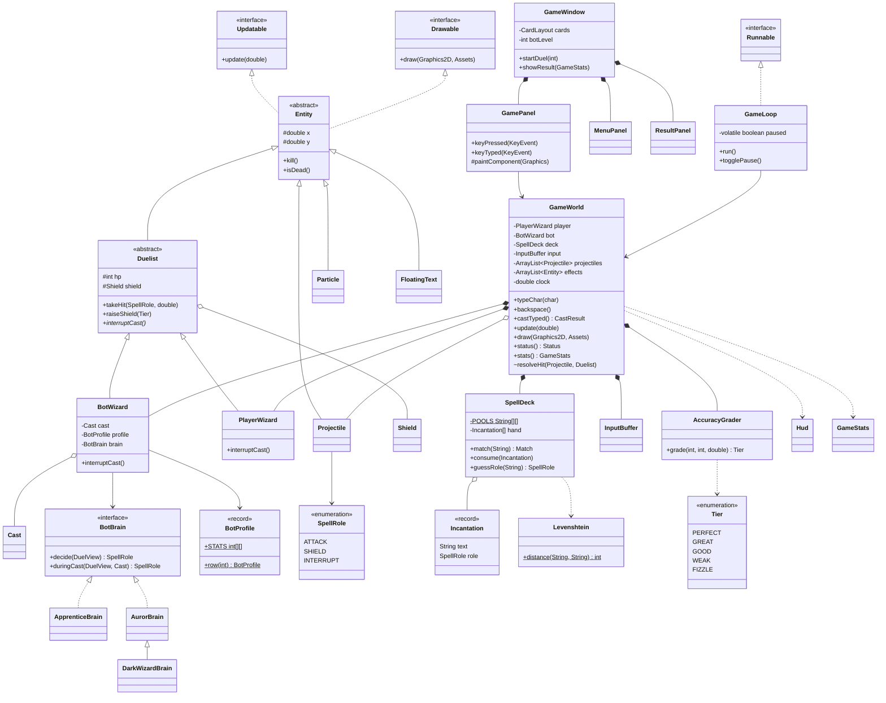

# DESIGN: Spell Duel

เอกสารออกแบบสถาปัตยกรรมที่อนุมัติแล้ว (27 ต.ค. 2026 แทนฉบับ tower defense เมื่อ 11 ต.ค.) ใช้คู่กับ `SPEC.md`: SPEC บอกว่าเกมต้อง**ทำอะไร** ส่วนเอกสารนี้บอกว่าโค้ด**จัดโครงอย่างไร**
ถ้าตอนเขียนโค้ดต้องเบี่ยงจากเอกสารนี้ ให้แก้เอกสารก่อน แล้วค่อยแก้โค้ด

## 1. ภาพรวม

เปรียบเกมเป็นสนามมวย:
- **`GameWorld` = กรรมการ + สนาม** รู้กติกาทั้งหมด (ใครโดนตี โล่กันได้ไหม ใครชนะ) และถือข้อมูลทุกอย่างของการดวล 1 ครั้ง
- **`PlayerWizard` / `BotWizard` = นักมวยสองคน** มี HP, โล่ และคาถาที่กำลังร่าย นักมวยไม่ตัดสินเอง ทุกอย่างผ่านกรรมการ
- **`BotBrain` = โค้ชของบอท** ดูสถานการณ์แล้วบอกบอทว่าจะร่ายอะไรต่อ เปลี่ยนโค้ชก็ได้บอทนิสัยใหม่
- **Swing = กล้องถ่ายทอดสด** รับปุ่มที่ผู้เล่นกดแล้วส่งให้กรรมการ และวาดภาพสนาม ห้ามแก้ข้อมูลในเกมเอง
- **`GameLoop` = นาฬิกาจับเวลา** มี thread เดียว ทุก ~1/60 วินาทีจะเรียก `world.update(dt)` แล้วเรียก `panel.repaint()`

ข้อดี: กรรมการไม่ต้องมีจอ จึงทดสอบกติกาทั้งหมดด้วย JUnit ได้โดยไม่ต้องเปิดเกม

## 2. Package

dependency ชี้ไปทางเดียว ห้ามย้อนกลับ: `ui ──▶ model ──▶ typing`

| Package | มีอะไร | กฎ |
|---|---|---|
| `spellduel.typing` | `Levenshtein`, `Tier`, `AccuracyGrader`, `InputBuffer` (**ของเดิม** เปลี่ยนชื่อ package และเกณฑ์ `Tier`: Good ≥ 75%, Weak ≥ 50%) | logic ล้วน ใช้แค่ JDK |
| `spellduel.model` | `GameWorld`, นักเวท, การ์ด, สมองบอท, projectile, effect, `Hud`, `Assets`, `GameStats` | ใช้ `java.awt` ได้ แต่**ห้าม import `javax.swing`** (`ArchitectureTest` ตรวจ) · ทุก class เป็น package-private ยกเว้น `GameWorld`, `GameStats`, `Assets` |
| `spellduel.ui` | `GameWindow`, `MenuPanel`, `GamePanel`, `ResultPanel`, `GameLoop` | Swing อยู่ที่นี่ที่เดียว คุยกับ model ผ่าน `GameWorld` เท่านั้น |
| `spellduel` | `Main` | เปิดหน้าต่างผ่าน `SwingUtilities.invokeLater` |

`InputBuffer.MAX_LENGTH = 24` พอสำหรับคาถาที่ยาวที่สุด (`petrificus totalus` / `protego horribilis` = 18 ตัว)

## 3. Thread (ยกกฎเดิมมาทั้งหมด)

- **กฎข้อเดียว:** public method **ทุกตัว**ของ `GameWorld` เป็น `synchronized` ใครจะเข้าต้องถือกุญแจ และเข้าได้ทีละคน
- **ลบทีหลัง:** ระหว่าง `update` ของบนจอเรียกแค่ `kill()` แล้ว `sweepDead()` ลบทีเดียวตอนท้าย tick
- **ห้ามเรียก Swing ระหว่างถือกุญแจ:** ตอนจบเกม `GameLoop` ดึง `world.stats()` ออกมาก่อน แล้วค่อย `SwingUtilities.invokeLater(...)` ไปหน้า Result
- **Pause** ใช้ `volatile boolean paused` ใน `GameLoop` ห้ามใช้ `Thread.suspend()`
- **dt** วัดจาก `System.nanoTime()` และจำกัดด้วย `MAX_DT` · **เวลาในเกม** `GameWorld.clock` = ผลรวม dt ใช้กับทุกอย่าง (parTime, cast bar, โล่, พักของบอท) ตอน pause จึงไม่นับเวลา และเทสต์คุมเวลาได้ด้วย `update(dt)`
- **Focus:** หลังสลับ card ต้องเรียก `requestFocusInWindow()` และ `GamePanel` ต้องเรียก `setFocusTraversalKeysEnabled(false)`

## 4. Public API ของ `GameWorld`

```java
public GameWorld(int botLevel, long seed)           // ดวล 1 ครั้ง (0 = Apprentice, 1 = Auror, 2 = Dark Wizard) · Retry = new GameWorld(เลเวลเดิม)
public synchronized void typeChar(char c)           // EDT
public synchronized void backspace()                // EDT
public synchronized CastResult castTyped()          // EDT: Enter
public synchronized void update(double dt)          // game thread
public synchronized void draw(Graphics2D g, Assets assets) // EDT
public synchronized Status status()                 // PLAYING / WON / LOST
public synchronized GameStats stats()               // record ที่แก้ไม่ได้ ใช้ในหน้า Result
public static final int BOT_COUNT = 3;
```

เทสต์ใช้ constructor แบบ package-private: `new GameWorld(BotProfile.row(i), brain, SpellDeck.standard(new Random(1)))` และ hook `playerCasts(SpellRole, Tier)` / `botCasts(...)` เพื่อจัดฉากได้ตรง ๆ

## 5. กติกาการดวล

### 5.1 ผู้เล่นร่าย (`castTyped()` ที่เดียว)
ตัวอย่าง: การ์ด Attack คือ `bombarda maxima` แล้วผู้เล่นพิมพ์ `bombarda maxma` กด Enter
1. `InputBuffer` ให้ข้อความที่พิมพ์ และเวลาที่ใช้ (นับจากกดตัวแรก) แล้วล้าง buffer
2. `SpellDeck.match(typed)` เทียบกับการ์ด **3 ใบที่อยู่บนมือ** ด้วย Levenshtein → การ์ด Attack, distance 1 (ถ้าเสมอกันเลือกคำที่สั้นกว่า)
3. `AccuracyGrader.grade(distance, length, seconds)` → Great
4. ถ้าได้ FIZZLE จะขึ้นข้อความ "Fizzle!" แล้วจบ (การ์ดไม่ถูกใช้)
5. ถ้าไม่ใช่ FIZZLE: `deck.consume(card)` สุ่มคำใหม่ให้การ์ดใบนั้น แล้วทำตามหน้าที่ (§5.3)

### 5.2 บอทร่าย
- `BotWizard` ถือ `Cast` ที่กำลังร่าย (หน้าที่, คำ, `duration = length / profile.cps`, `elapsed`) ซึ่งก็คือ cast bar บนจอ
- เมื่อ `elapsed ≥ duration` บอทจะร่ายออก โดย Tier สุ่มด้วย `Random` จาก `profile.accuracy` แล้วทำตาม §5.3 เหมือนผู้เล่น
- ตอนที่บอทว่าง และผ่านช่วงพัก (`profile.reaction`) ไปแล้ว `GameWorld` จะถาม `brain.decide(view)` ว่าจะร่ายอะไรต่อ
- ระหว่างที่ร่ายอยู่ ทุก tick จะเรียก `brain.duringCast(view, cast)` ด้วย ซึ่งเป็นช่องที่ Dark Wizard ใช้เปลี่ยนคาถา

### 5.3 ผลของแต่ละหน้าที่ (`GameWorld` ตัดสิน · `power = base × tier.multiplier()`)

| ร่าย | เกิดอะไร | เมื่อไปถึงเป้า |
|---|---|---|
| **Attack** | ปล่อย `Projectile` บินข้ามจอ (~0.6 วินาที) | ถ้าเป้ามีโล่ที่ยังไม่หมด: **สะท้อน** projectile กลับไปหาผู้ร่ายเสมอ (โล่หาย เป้าไม่เสีย HP) · ถ้าไม่มีโล่: HP ลดเท่ากับ power และ**ตัด cast** ของเป้า (บอทเสีย cast bar, ผู้เล่นเสียข้อความที่พิมพ์ค้าง) |
| **Interrupt** | ปล่อย `Projectile` ที่เร็วกว่า Attack | **ทำลายโล่** + HP ลดเล็กน้อย (ไม่สนว่ามีโล่หรือไม่) · ตัด cast ได้**เฉพาะ cast ที่เป็น Shield** (ตัด Attack ไม่ได้) |
| **Shield** | ตั้ง `Shield` บนตัวผู้ร่ายทันที นาน 3 วินาที | ทุก tier กัน Attack ได้เต็มและสะท้อนกลับ · แรงของลูกสะท้อน = power ของ Attack × ตัวคูณ tier ของโล่ (PERFECT ×1.25 · Great ×1.0 · Good ×0.6 · Weak ×0.3) |

**ต้องแม่นถึงจะตัดได้:** การตัด cast (ทั้งของ Attack และ Interrupt) เกิดเฉพาะเมื่อ projectile เป็น **GREAT หรือ PERFECT** ส่วน GOOD/WEAK ทำได้แค่ดาเมจ (และ Interrupt ยังทำลายโล่ได้ทุก tier)
"cast ของเป้าเป็นหน้าที่อะไร": บอทดูจาก `cast.role()` · ผู้เล่นดูจาก `SpellDeck.guessRole(ข้อความที่พิมพ์)` (นิยามเดียวกับที่บอทใช้อ่านทาง)
เหตุผล (27 ต.ค. playtest prototype): เดิมพิมพ์คำสั้น ๆ/ครึ่งคำของ Interrupt รัว ๆ ก็ตัดบอทได้ทุกครั้งจนบอทร่ายไม่เคยเสร็จ ผู้เล่นจำลองชนะบอททุกตัว 40/40 โดยไม่ต้องตัดสินใจเลย

วงจรจึงเป็นเป่ายิ้งฉุบครบวง: **Attack ชนะ Interrupt** (ตัดไม่ได้ และแรงกว่า) · **Interrupt ชนะ Shield** · **Shield ชนะ Attack**

"ร่ายเสร็จก่อนชนะ" จึงเกิดเองโดยไม่ต้องมีกฎพิเศษ: ถ้าการโจมตีที่แม่นพอของผู้เล่นไปถึงก่อน cast bar ของบอทเต็ม คาถาของบอทจะถูกตัด

### 5.4 จบเกม
HP ฝั่งใดถึง 0 → `status()` เป็น WON หรือ LOST · `GameLoop` เห็นแล้วพาไปหน้า Result
`GameWindow` เก็บ `botLevel` ไว้: ชนะ → Next (`level + 1`) · แพ้ → Retry (เลเวลเดิม) · ชนะเลเวล 2 → หน้า "จบเกม"

## 6. บอท

### 6.1 `BotProfile`: ตาราง `int[][] STATS` (แถว = บอท)

| บอท | HP | cps×10 (ความเร็วพิมพ์) | accuracy % | reaction ms (พักก่อนร่ายต่อ) |
|---|---|---|---|---|
| 0 Apprentice | 60 | 25 | 70 | 1500 |
| 1 Auror | 90 | 35 | 85 | 700 |
| 2 Dark Wizard | 120 | 45 | 95 | 400 |

ผู้เล่นมี HP 100 · ค่า base: Attack 20, Interrupt 5 (ค่าเริ่มต้น ปรับตอน playtest D4)
`BotProfile.row(i)` แปลงแถวเป็น record (`cps = cps×10 / 10.0`) และ constructor ไม่ยอมรับแถวที่ความกว้างผิด

### 6.2 `interface BotBrain`
```java
interface BotBrain {
    SpellRole decide(DuelView view);                     // ตอนว่าง: ร่ายอะไรต่อ
    default SpellRole duringCast(DuelView view, Cast c) { return null; } // null = ไม่เปลี่ยน
}
```
`DuelView` เป็น record ที่อ่านได้อย่างเดียว ส่งให้สมองบอทดู: HP ทั้งสองฝั่ง, ผู้เล่นมีโล่ไหม, `playerIntent` (หน้าที่ที่ผู้เล่นน่าจะกำลังพิมพ์) และ `Random`

| Brain | นิสัย |
|---|---|
| `ApprenticeBrain` | คืน ATTACK ทุกครั้ง |
| `AurorBrain` | ถ้า `playerIntent == ATTACK` ร่าย SHIELD · ถ้าผู้เล่นมีโล่ ร่าย INTERRUPT · กรณีอื่นร่าย ATTACK |
| `DarkWizardBrain` | ตอนตัดสินใจใช้กฎเดียวกับ Auror · ใน `duringCast` เมื่อร่ายไปเกินครึ่งทาง มีโอกาส 30% (ครั้งเดียวต่อ cast) ที่จะเปลี่ยนเป็นหน้าที่อื่น cast bar เปลี่ยนป้ายแต่เวลาที่เหลือเท่าเดิม |

**`playerIntent`** มีนิยามเดียวคือ `SpellDeck.guessRole(prefix)` ถ้าพิมพ์ไปแล้วอย่างน้อย 3 ตัว จะเทียบสิ่งที่พิมพ์กับ "ต้นคำ" ของการ์ดแต่ละใบ (ตัดคำให้ยาวเท่าที่พิมพ์) ด้วย Levenshtein แล้วคืนหน้าที่ของการ์ดที่ใกล้ที่สุด ถ้าพิมพ์ยังไม่ถึง 3 ตัว คืน `null`

## 7. การ์ด: `SpellDeck`

- `enum SpellRole { ATTACK, SHIELD, INTERRUPT }` เก็บ `base`, `label`, สี และความเร็ว projectile ไว้ใน enum
- `static final String[][] POOLS` (แถว = role ตามลำดับ `ordinal()`, คอลัมน์ = 5 คาถาใน SPEC §2) เป็น **2D array**
- `Incantation[] hand` (3 ใบ, ใบละ role) · `consume(card)` สุ่มคำใหม่จากแถวเดิม โดยห้ามซ้ำกับคำปัจจุบัน
- บอทก็สุ่มคำจาก `POOLS` เหมือนกัน (เพื่อเอามาแสดงบน cast bar และคำนวณ duration) แต่ไม่ได้ใช้มือของผู้เล่น

## 8. Class diagram



## 9. แต่ละเรื่องมีเจ้าของคนเดียว

| ข้อมูล / กฎ | เจ้าของ | คนอื่นทำได้แค่ |
|---|---|---|
| ข้อความที่พิมพ์ + เวลาเริ่ม | `InputBuffer` | `GameWorld` ส่ง `clock` เข้าไป · `PlayerWizard.interruptCast()` สั่งล้าง |
| ตัวคูณและค่าตัดของ Tier | `Tier` | |
| คำบนการ์ด 3 ใบ + การสุ่มใหม่ | `SpellDeck` | HUD อ่าน `hand()` |
| "ผู้เล่นกำลังพิมพ์หน้าที่อะไร" | `SpellDeck.guessRole` | ทั้ง Auror และ Dark Wizard ใช้ตัวนี้ผ่าน `DuelView` |
| cast bar ของบอท | `BotWizard.cast` | HUD อ่าน `progress()` และ `role()` |
| HP + โล่ | `Duelist` | `GameWorld.resolveHit` เป็นคนเรียก `takeHit` |
| กติกาว่าโดนแล้วเกิดอะไร (§5.3) | `GameWorld.resolveHit` **ที่เดียว** | |
| stat ของบอท | `BotProfile.STATS` | |
| นิสัยบอท | `BotBrain` แต่ละตัว | |

## 10. หัวข้อที่เรียน → class ที่ใช้ (ใช้ในรายงานและสไลด์)

| หัวข้อ | ใช้ที่ไหน |
|---|---|
| Class/Object | `Duelist`, `Cast`, `Shield`, `SpellDeck`, `Incantation` |
| Method | `Levenshtein.distance`, `SpellDeck.match/guessRole`, `AccuracyGrader.grade`, `GameWorld.resolveHit` |
| Array | `Incantation[] hand`, `int[] tierCounts` ใน `GameStats` |
| 2D array | `String[][] POOLS`, `int[][] STATS`, `int[][] dp` ใน `Levenshtein` |
| ArrayList | `projectiles`, `effects` |
| Inheritance | `Entity → Duelist → PlayerWizard/BotWizard`, `AurorBrain → DarkWizardBrain` |
| Polymorphism | `brain.decide(...)` (บอท 3 นิสัย), `duelist.interruptCast()` (ผู้เล่นล้างช่องพิมพ์ / บอททิ้ง cast bar), `entity.draw(...)` |
| Interface/Abstract | `BotBrain`, `Updatable`, `Drawable`, `Runnable` · `abstract Entity/Duelist` |
| GUI/Event | `GameWindow` (CardLayout), `MenuPanel`/`ResultPanel` (ActionListener), `GamePanel` (KeyListener) |
| Graphics | `draw(Graphics2D)` ของแต่ละ entity, `Hud` (การ์ด, cast bar, HP bar), `Assets` |
| Thread | `GameLoop implements Runnable`, `volatile`, `synchronized`, `invokeLater` |

## 11. Test (JUnit 5, เทสต์เฉพาะ model)

| Test class | ตรวจอะไร | วัน |
|---|---|---|
| `LevenshteinTest`, `AccuracyGraderTest`, `InputBufferTest`, `ArchitectureTest` | ของเดิม (เปลี่ยน package และเกณฑ์ Tier) | D1 |
| `SpellDeckTest` | match ได้การ์ดที่ถูก, consume แล้วได้คำใหม่ที่ไม่ซ้ำ, แต่ละแถวใน POOLS มีอย่างน้อย 3 คำ, `guessRole` คืน null ถ้าพิมพ์ไม่ถึง 3 ตัว | D2 |
| `GameWorldTest` | ทุกแถวใน §5.3 รวมถึงสะท้อน, ทำลายโล่, Fizzle แล้วการ์ดยังอยู่, โดนตีแล้ว buffer ถูกล้าง, WON/LOST | D2 |
| `BotBrainTest` | Apprentice ร่ายแต่ ATTACK, Auror ตั้งโล่เมื่อ intent = ATTACK, Dark Wizard เปลี่ยนหน้าที่ (seed คงที่) | D3 |
| `BotProfileTest` | ทุกแถวกว้างเท่ากัน, ค่าบอทตัวหลังเก่งกว่าตัวก่อน | D3 |

## 12. ถ้าเวลาไม่พอ ให้ตัดตามลำดับนี้
1. การหลอกของ Dark Wizard → ให้เป็น Auror ที่เร็วขึ้นแทน (ยังมี subclass อยู่)
2. แรงลูกสะท้อนตาม tier ของโล่ → สะท้อนแรงเท่าเดิมทุก tier (ห้ามตัดการสะท้อนทิ้ง เพราะเป็นทางที่ Shield ชนะ Attack)
3. sprite → ใช้รูปทรง + สี (`Assets.none()`)

## 13. สิ่งที่ตั้งใจไม่ทำ
- ไม่มี thread แยกต่อตัวละคร · ไม่มี `reset()` (Retry = สร้าง `GameWorld` ใหม่)
- ไม่มี cooldown หรือ mana · ไม่มี event bus หรือ design pattern ที่ซับซ้อนเกินกว่าจะอธิบายได้

## 14. ทางเลือกที่พิจารณาแล้วไม่เลือก

| ทางเลือก | ทำไมไม่เลือก |
|---|---|
| ปรับ tower defense ต่อ | playtest แล้วไม่สนุก ปัญหา 4 ข้อใน SPEC เป็นปัญหาที่ตัวแนวเกม ไม่ใช่ตัวเลข |
| แข่งพิมพ์ล้วน (ใครเสร็จก่อนได้ตี) | ไม่มีการตัดสินใจ กลายเป็นเกมฝึกพิมพ์ |
| Turn-based | ช้า และทำให้หัวข้อ Thread ดูไม่เด่น |
| Beam Clash เป็น must-have | ต้องเพิ่มโหมดย่อยอีก 1 โหมด ไม่ทันใน 4 วัน จึงย้ายไป nice-to-have |
| บอทต่างกันแค่ตัวเลข | บอททั้ง 3 ตัวจะรู้สึกเหมือนกัน และเสีย polymorphism ที่จะโชว์ในรายงาน |
| คาถา 3 คำตายตัว | ผู้เล่นพิมพ์คำเดิมซ้ำจนเบื่อ (ปัญหาเดียวกับ tower defense) |
| เขียน `typing` ใหม่ | ของเดิมใช้กับเกมแนวไหนก็ได้ และมี test ผ่านอยู่แล้ว |
