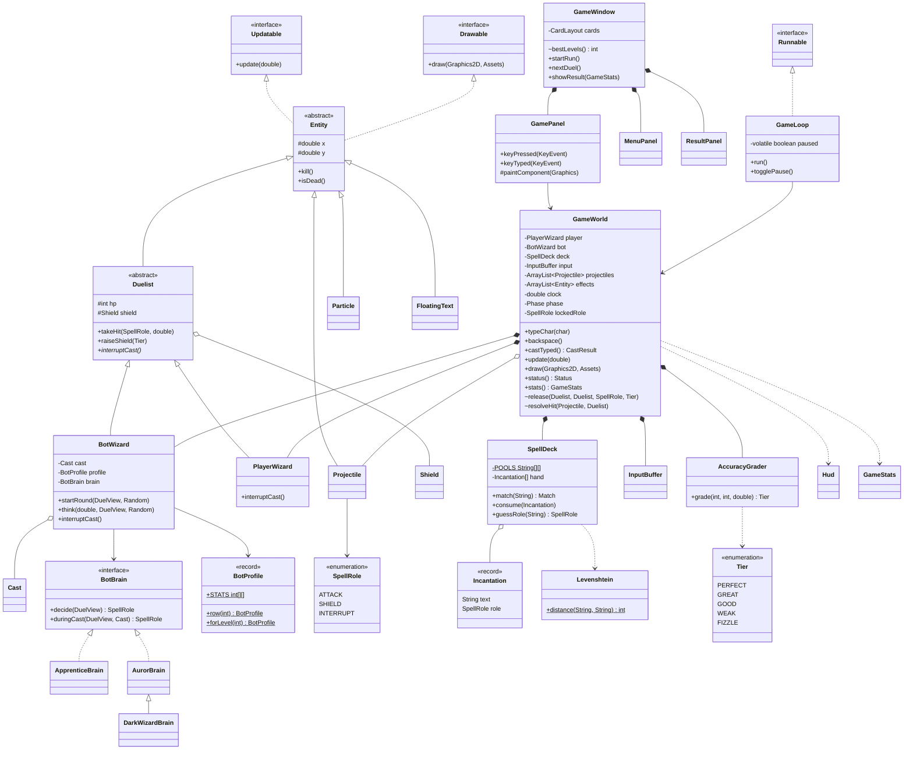

# DESIGN: Spell Duel

เอกสารออกแบบสถาปัตยกรรมที่อนุมัติแล้ว (27 ต.ค. 2026 แทนฉบับ tower defense เมื่อ 11 ต.ค. · 31 ต.ค. เปลี่ยนกติกาเป็นแบบรอบ · 1 พ.ย. สรุปเป็นร่ายทันทีและไต่ด่าน) ใช้คู่กับ `SPEC.md`: SPEC บอกว่าเกมต้อง**ทำอะไร** ส่วนเอกสารนี้บอกว่าโค้ด**จัดโครงอย่างไร**
ถ้าตอนเขียนโค้ดต้องเบี่ยงจากเอกสารนี้ ให้แก้เอกสารก่อน แล้วค่อยแก้โค้ด

## 1. ภาพรวม

เปรียบเกมเป็นสนามมวย:
- **`GameWorld` = กรรมการ + สนาม** รู้กติกาทั้งหมด (ใครโดนตี โล่กันได้ไหม ใครชนะ) และถือข้อมูลทุกอย่างของการดวล 1 ครั้ง
- **`PlayerWizard` / `BotWizard` = นักมวยสองคน** มี HP, โล่ และคาถาที่กำลังร่าย นักมวยไม่ตัดสินเอง ทุกอย่างผ่านกรรมการ
- **`BotBrain` = โค้ชของบอท** ดูสถานการณ์แล้วบอกบอทว่าจะร่ายอะไรต่อ เปลี่ยนโค้ชก็ได้บอทนิสัยใหม่
- **Swing = กล้องถ่ายทอดสด** รับปุ่มที่ผู้เล่นกดแล้วส่งให้กรรมการ และวาดภาพสนาม ห้ามแก้ข้อมูลในเกมเอง
- **`GameLoop` = นาฬิกาจับเวลา** มี thread เดียว ทุก ~1/60 วินาทีจะเรียก `world.update(dt)` แล้วเรียก `panel.repaint()`

ข้อดี: กรรมการไม่ต้องมีจอ จึงทดสอบกติกาทั้งหมดด้วย JUnit ได้โดยไม่ต้องเปิดเกม

## 2. Package

dependency ชี้ไปทางเดียว ห้ามย้อนกลับ: `ui ──▶ model ──▶ typing`

| Package | มีอะไร | กฎ |
|---|---|---|
| `spellduel.typing` | `Levenshtein`, `Tier`, `AccuracyGrader`, `InputBuffer` (**ของเดิม** เปลี่ยนชื่อ package และเกณฑ์ `Tier`: Good ≥ 75%, Weak ≥ 50%) | logic ล้วน ใช้แค่ JDK |
| `spellduel.model` | `GameWorld`, นักเวท, การ์ด, สมองบอท, projectile, effect, `Hud`, `Assets`, `GameStats` | ใช้ `java.awt` ได้ แต่**ห้าม import `javax.swing`** (`ArchitectureTest` ตรวจ) · ทุก class เป็น package-private ยกเว้น `GameWorld`, `GameStats`, `Assets` |
| `spellduel.ui` | `GameWindow`, `MenuPanel`, `GamePanel`, `ResultPanel`, `GameLoop` | Swing อยู่ที่นี่ที่เดียว คุยกับ model ผ่าน `GameWorld` เท่านั้น |
| `spellduel` | `Main` | เปิดหน้าต่างผ่าน `SwingUtilities.invokeLater` |

`InputBuffer.MAX_LENGTH = 24` พอสำหรับคาถาที่ยาวที่สุด (`petrificus totalus` / `protego horribilis` = 18 ตัว)

## 3. Thread (ยกกฎเดิมมาทั้งหมด)

- **กฎข้อเดียว:** public method **ทุกตัว**ของ `GameWorld` เป็น `synchronized` ใครจะเข้าต้องถือกุญแจ และเข้าได้ทีละคน
- **ลบทีหลัง:** ระหว่าง `update` ของบนจอเรียกแค่ `kill()` แล้ว `sweepDead()` ลบทีเดียวตอนท้าย tick
- **ห้ามเรียก Swing ระหว่างถือกุญแจ:** ตอนจบเกม `GameLoop` ดึง `world.stats()` ออกมาก่อน แล้วค่อย `SwingUtilities.invokeLater(...)` ไปหน้า Result
- **Pause** ใช้ `volatile boolean paused` ใน `GameLoop` ห้ามใช้ `Thread.suspend()`
- **dt** วัดจาก `System.nanoTime()` และจำกัดด้วย `MAX_DT` · **เวลาในเกม** `GameWorld.clock` = ผลรวม dt ใช้กับทุกอย่าง (parTime, cast bar, โล่, พักของบอท) ตอน pause จึงไม่นับเวลา และเทสต์คุมเวลาได้ด้วย `update(dt)`
- **วาดจอ:** `GamePanel` วาดเฟรมลง `BufferedImage` ก่อนแล้วค่อยแปะขึ้นจอ เพราะไล่สีและโปร่งใสที่วาดตรงลงจอช้า (วัดบน Linux: 60 ms → 4.5 ms ต่อเฟรม) และทำให้ถือกุญแจของ `GameWorld` สั้นลง
- **Focus:** หลังสลับ card ต้องเรียก `requestFocusInWindow()` และ `GamePanel` ต้องเรียก `setFocusTraversalKeysEnabled(false)`

## 4. Public API ของ `GameWorld`

```java
public GameWorld(int botLevel, int playerHp, long seed) // ดวล 1 ด่าน (0 = Apprentice, 1 = Auror, 2 ขึ้นไป = Dark Wizard)
public synchronized void typeChar(char c)           // EDT
public synchronized void backspace()                // EDT
public synchronized CastResult castTyped()          // EDT: Enter
public synchronized void update(double dt)          // game thread
public synchronized void draw(Graphics2D g, Assets assets) // EDT
public synchronized Status status()                 // PLAYING / WON / LOST
public synchronized GameStats stats()               // record ที่แก้ไม่ได้ ใช้ในหน้า Result
public static final int PLAYER_MAX_HP = 100;
```

เทสต์ใช้ constructor แบบ package-private: `new GameWorld(BotProfile.row(i), brain, SpellDeck.standard(new Random(1)))` และ `release(caster, target, role, tier)` เพื่อจัดฉากการร่ายได้ตรง ๆ

## 5. กติกาการดวล

เปรียบเหมือนดวลปืนที่ต้องพิมพ์ก่อนยิง: ทั้งสองฝ่ายเริ่มพร้อมกันหลังกรรมการนับ 3-2-1 แต่ละฝ่ายมีกระสุนนัดเดียวต่อรอบ ใครพิมพ์เสร็จก่อนก็ยิงก่อน

### 5.1 วงจรของรอบ
`GameWorld.phase` มี 3 ช่วง: `COUNTDOWN → TYPING → REVEAL → รอบถัดไป`

ค่าคงที่อยู่ใน `GameWorld`: `COUNTDOWN_TIME` 0.9 วินาที · `GO_TIME` 0.4 วินาที · `ROUND_TIME` 8 วินาที · `REVEAL_TIME` 1.6 วินาที · `GRACE_TIME` 1 วินาที · `NO_SHIELD_SCALE` ×0.25

- **COUNTDOWN:** นับ 3-2-1 พิมพ์ไม่ได้และบอทยังไม่ร่าย แล้วขึ้น "เริ่ม!" ค้าง `GO_TIME` โดยไม่บังการเล่น
- **TYPING จบเมื่อ**เกิดข้อใดข้อหนึ่งก่อน
  1. ร่ายครบทั้งสองฝ่าย
  2. บอทร่ายเสร็จแล้วผ่านไป `GRACE_TIME` (กันการรอดูแล้วสวนสบาย ๆ)
  3. ครบ `ROUND_TIME` · ถ้าผู้เล่นยังไม่ร่าย ระบบเรียก `castTyped()` ส่งข้อความที่ค้างให้
- **REVEAL** จบเมื่อผ่าน `REVEAL_TIME` และไม่มีสายฟ้าบินอยู่ · `startRound` ล้างโล่ทั้งสองฝ่าย (**โล่อยู่รอบเดียว**) แล้วถามสมองบอท

### 5.2 ผู้เล่นร่าย (`castTyped()` ที่เดียว)
ตัวอย่าง: การ์ด Attack คือ `bombarda maxima` แล้วผู้เล่นพิมพ์ `bombarda maxma` กด Enter
1. `InputBuffer` ให้ข้อความที่พิมพ์ และเวลาที่ใช้ (นับจากกดตัวแรก) แล้วล้าง buffer
2. `SpellDeck.match(typed)` เทียบกับการ์ด **3 ใบที่อยู่บนมือ** ด้วย Levenshtein → การ์ด Attack, distance 1 (ถ้าเสมอกันเลือกคำที่สั้นกว่า)
3. `AccuracyGrader.grade(distance, length, seconds)` → Great
4. ถ้าได้ FIZZLE จะขึ้นข้อความ "Fizzle!" การ์ดไม่ถูกใช้ และพิมพ์ใหม่ได้ถ้ายังมีเวลา
5. ถ้าไม่ใช่ FIZZLE: `deck.consume(card)` สุ่มคำใหม่ให้การ์ดใบนั้น จำไว้ใน `lockedRole` แล้วเรียก `release` ให้คาถาทำงานทันที รอบนี้พิมพ์ต่อไม่ได้แล้ว

### 5.3 บอทร่าย
- ต้นรอบ `BotWizard.startRound` ถาม `brain.decide(view)` แล้วสร้าง `Cast` (หน้าที่, คำ, `duration = reaction + length / cps` ไม่เกิน `MAX_CAST`, `elapsed`) ซึ่งก็คือ cast bar บนจอ · การ์ด Shield ใช้เวลาพิมพ์ ×0.6 (`SHIELD_SPEED`) เพื่อให้ Attack รีบตีแซงโล่ได้ยากขึ้น
- `Cast.isRevealed()`: ถึง 20% ของแถบ (`REVEAL_AT`) จึงแสดงหน้าที่ ก่อนหน้านั้น HUD แสดง "???" (เดิมตั้ง 50% แต่ข้อมูลมาช้าจนพิมพ์สวนไม่ทัน)
- ทุก tick เรียก `brain.duringCast(view, cast)` ซึ่งเป็นช่องที่ Dark Wizard ใช้หลอก
- แถบเต็ม = บอทร่ายเสร็จ · `updateTyping` สุ่ม Tier ด้วย `Random` จาก `profile.accuracy` แล้วเรียก `release`

### 5.4 ผลของคาถา (`release` + `resolveHit` ตัดสิน · `power = base × tier.multiplier()`)

`release` ของ Shield ตั้งโล่ทันที ส่วน Attack และ Interrupt สร้าง `Projectile` แล้วตัดสินตอนถึงเป้า ผลจึงขึ้นกับจังหวะ

| สิ่งที่ถึงเป้า | เป้ามีโล่ | เป้าไม่มีโล่ |
|---|---|---|
| **Attack** | โล่แตก สะท้อนกลับใส่คนตี แรง = power × ตัวคูณ tier ของโล่ | ดาเมจเต็ม และขัดคาถาถ้าระดับ Great ขึ้นไป |
| **Interrupt** | โล่แตก + ดาเมจเต็ม | ดาเมจ ×0.25 (`NO_SHIELD_SCALE`) |

- **ขัด (`cutCast`):** Attack ระดับ Great ขึ้นไปที่โดนตัว ทำให้บอทเสียการร่ายรอบนั้น หรือผู้เล่นข้อความหายแต่พิมพ์ใหม่ได้ · ต้องแม่นก่อนจึงขัดได้ เพื่อกันการพิมพ์ครึ่งคำแล้วรีบกด Enter
- **ไม่ร่าย:** ไม่ปล่อยอะไร จึงโดนของอีกฝ่ายเต็ม ๆ
- **ภาพ:** Attack และ Interrupt วาดเป็นสายฟ้าหยัก (`Projectile.draw`) เขียว = Attack, แดง = Interrupt สีอยู่ที่ `SpellRole` การ์ดและเอฟเฟกต์จึงสีตรงกัน การสุ่มรูปร่างใช้ `Random` แยกจากเกม จึงไม่กระทบผลการต่อสู้

เหตุผล: แบบ real-time พิมพ์ใบเดียวรัวก็ชนะ และ Interrupt แทบไม่ได้ใช้ (31 ต.ค.) ส่วนแบบรอบทำให้ทุกใบมีทางชนะ แต่ต้องรอเปิดไพ่พร้อมกัน (31 ต.ค.) จึงเปลี่ยนเป็นคาถาทำงานทันทีเมื่อร่ายเสร็จ (1 พ.ย.) ทุกใบยังมีทางชนะ และพิมพ์เร็วได้เปรียบเรื่องจังหวะ · ผู้เล่นจำลอง 200 รอบที่พิมพ์ไม่ผิด 5 ตัว/วินาที: รัว Attack ผ่านเฉลี่ย 1.3 ด่าน สุ่มการ์ด 2.3 ด่าน จับนิสัยแล้วเดา 4.8 ด่าน

### 5.5 จบเกมและไต่ด่าน
HP ฝั่งใดถึง 0 → `status()` เป็น WON หรือ LOST · `GameLoop` เห็นแล้วพาไปหน้า Result
`GameWindow` เป็นเจ้าของการเล่น 1 รอบ: ชนะ → ด่านถัดไปพร้อม `stats.nextHp()` (HP ที่เหลือ + `HEAL_PER_WIN` 75 ไม่เกิน 100) · แพ้ → เริ่มด่าน 1 ใหม่ · ด่านไม่มีวันหมด · สถิติด่านสูงสุดเก็บด้วย `java.util.prefs.Preferences`

## 6. บอท

### 6.1 `BotProfile`: ตาราง `int[][] STATS` (แถว = บอท)

| บอท | HP | cps×10 (ความเร็วพิมพ์) | accuracy % | reaction ms (พักก่อนร่ายต่อ) |
|---|---|---|---|---|
| 0 Apprentice | 80 | 30 | 75 | 1000 |
| 1 Auror | 100 | 36 | 85 | 650 |
| 2 Dark Wizard | 115 | 41 | 90 | 500 |

ด่านหลังจากนี้ใช้ `BotProfile.forLevel`: Dark Wizard +N ได้ HP +5, cps +0.1 (สูงสุด 8), accuracy +1 (สูงสุด 99), reaction −0.02 วินาที (ต่ำสุด 0.1) ต่อด่าน

ผู้เล่นมี HP 100 · ค่า base: Attack 20, Interrupt 20 · `reaction` บวกเข้าไปในเวลาร่ายของทุกรอบ
`BotProfile.row(i)` แปลงแถวเป็น record (`cps = cps×10 / 10.0`) และ constructor ไม่ยอมรับแถวที่ความกว้างผิด

### 6.2 `interface BotBrain`
```java
interface BotBrain {
    SpellRole decide(DuelView view);                     // ต้นรอบ: จะร่ายอะไร
    default SpellRole duringCast(DuelView view, Cast c) { return null; } // null = ไม่เปลี่ยน
}
```
`DuelView` เป็น record ที่อ่านได้อย่างเดียว ส่งให้สมองบอทดู: HP ทั้งสองฝั่ง, สถานะโล่, `playerIntent`, `lastPlayerRole` (การ์ดรอบก่อนของผู้เล่น) และ `Random`

| Brain | นิสัย |
|---|---|
| `ApprenticeBrain` | ATTACK 70% · ที่เหลือสุ่ม SHIELD หรือ INTERRUPT |
| `AurorBrain` | ถ้ามี `lastPlayerRole`: 55% ออก `lastPlayerRole.beatenBy()` · นอกนั้นสุ่ม 3 ใบ |
| `DarkWizardBrain` | ตอนตัดสินใจใช้กฎเดียวกับ Auror (สืบทอด) · ใน `duringCast` เมื่อถึง 3/4 แถบ มีโอกาส 30% (ครั้งเดียวต่อ cast) ที่จะเปลี่ยนหน้าที่ ป้ายบน cast bar เปลี่ยนแต่เวลาที่เหลือเท่าเดิม |

ตอนนี้ไม่มีบอทตัวไหนใช้ `playerIntent` · `SpellDeck.guessRole` ยังใช้จริงกับ HUD เพื่อไฮไลต์การ์ดที่ผู้เล่นกำลังพิมพ์

## 7. การ์ด: `SpellDeck`

- `enum SpellRole { ATTACK, SHIELD, INTERRUPT }` เก็บ `base`, `label`, สี, ความเร็ว projectile และ `beatenBy()` (ใบที่ชนะใบนี้) ไว้ใน enum
- `static final String[][] POOLS` (แถว = role ตามลำดับ `ordinal()`, คอลัมน์ = 5 คาถาใน SPEC §2) เป็น **2D array**
- `Incantation[] hand` (3 ใบ, ใบละ role) · `consume(card)` สุ่มคำใหม่จากแถวเดิม โดยห้ามซ้ำกับคำปัจจุบัน
- บอทก็สุ่มคำจาก `POOLS` เหมือนกัน (เพื่อเอามาแสดงบน cast bar และคำนวณ duration) แต่ไม่ได้ใช้มือของผู้เล่น

## 8. Class diagram



## 9. แต่ละเรื่องมีเจ้าของคนเดียว

| ข้อมูล / กฎ | เจ้าของ | คนอื่นทำได้แค่ |
|---|---|---|
| ข้อความที่พิมพ์ + เวลาเริ่ม | `InputBuffer` | `GameWorld` ส่ง `clock` เข้าไป · `PlayerWizard.interruptCast()` สั่งล้าง |
| ตัวคูณและค่าตัดของ Tier | `Tier` | |
| คำบนการ์ด 3 ใบ + การสุ่มใหม่ | `SpellDeck` | HUD อ่าน `hand()` |
| "ผู้เล่นกำลังพิมพ์หน้าที่อะไร" | `SpellDeck.guessRole` | HUD ใช้ไฮไลต์การ์ด |
| ช่วงของรอบ + การ์ดที่ผู้เล่นใช้ในรอบนี้ | `GameWorld` | HUD อ่านผ่าน `draw` |
| ใบไหนชนะใบไหน | `SpellRole.beatenBy` | Auror ใช้เลือกการ์ด |
| cast bar ของบอท | `BotWizard.cast` | HUD อ่าน `progress()` และ `role()` |
| HP + โล่ | `Duelist` | `GameWorld.resolveHit` เป็นคนเรียก `takeHit` |
| กติกาว่าคาถาทำอะไร (§5.4) | `GameWorld.release` + `resolveHit` **ที่เดียว** | |
| stat ของบอท | `BotProfile.STATS` + `forLevel` | |
| ด่านปัจจุบัน + สถิติสูงสุด | `GameWindow` | `ResultPanel`, `MenuPanel` แสดงผล |
| นิสัยบอท | `BotBrain` แต่ละตัว | |

## 10. หัวข้อที่เรียน → class ที่ใช้ (ใช้ในรายงานและสไลด์)

| หัวข้อ | ใช้ที่ไหน |
|---|---|
| Class/Object | `Duelist`, `Cast`, `Shield`, `SpellDeck`, `Incantation` |
| Method | `Levenshtein.distance`, `SpellDeck.match/guessRole`, `AccuracyGrader.grade`, `GameWorld.resolveHit` |
| Array | `Incantation[] hand`, `int[] tierCounts` ใน `GameStats` |
| 2D array | `String[][] POOLS`, `int[][] STATS`, `int[][] dp` ใน `Levenshtein` |
| ArrayList | `projectiles`, `effects` |
| Inheritance | `Entity → Duelist → PlayerWizard/BotWizard`, `AurorBrain → DarkWizardBrain` |
| Polymorphism | `brain.decide(...)` (บอท 3 นิสัย), `duelist.interruptCast()` (ถูกขัดหรือจบรอบ: ผู้เล่นล้างช่องพิมพ์ / บอททิ้ง cast bar), `entity.draw(...)` |
| Interface/Abstract | `BotBrain`, `Updatable`, `Drawable`, `Runnable` · `abstract Entity/Duelist` |
| GUI/Event | `GameWindow` (CardLayout), `MenuPanel`/`ResultPanel` (ActionListener), `GamePanel` (KeyListener) |
| Graphics | `draw(Graphics2D)` ของแต่ละ entity, `Hud` (การ์ด, cast bar, HP bar), `Assets` |
| Thread | `GameLoop implements Runnable`, `volatile`, `synchronized`, `invokeLater` |

## 11. Test (JUnit 5, เทสต์เฉพาะ model)

| Test class | ตรวจอะไร | วัน |
|---|---|---|
| `LevenshteinTest`, `AccuracyGraderTest`, `InputBufferTest`, `ArchitectureTest` | ของเดิม (เปลี่ยน package และเกณฑ์ Tier) | D1 |
| `SpellDeckTest` | match ได้การ์ดที่ถูก, consume แล้วได้คำใหม่ที่ไม่ซ้ำ, แต่ละแถวใน POOLS มีอย่างน้อย 3 คำ, `guessRole` คืน null ถ้าพิมพ์ไม่ถึง 3 ตัว | D2 |
| `GameWorldTest` | ทุกช่องในตาราง §5.4, การขัด, Fizzle แล้วการ์ดยังอยู่, นับถอยหลัง, วงจรรอบ, `GRACE_TIME`, WON/LOST, HP ข้ามด่าน | D2 |
| `BotBrainTest` | วงจร `beatenBy`, Apprentice ออก ATTACK ส่วนใหญ่, Auror สวนการ์ดรอบก่อน, เปิดหน้าที่ตอนแถบถึง 20%, Dark Wizard หลอกตามเงื่อนไข, บอทล็อกก่อนหมดรอบเสมอ (seed คงที่) | D3 |
| `BotProfileTest` | ทุกแถวกว้างเท่ากัน, ค่าบอทตัวหลังเก่งกว่าตัวก่อน, ด่านเกินตารางเก่งขึ้นและไม่เกินเพดาน | D3 |

## 12. ถ้าเวลาไม่พอ ให้ตัดตามลำดับนี้
1. การหลอกของ Dark Wizard → ให้เป็น Auror ที่เร็วขึ้นแทน (ยังมี subclass อยู่)
2. แรงลูกสะท้อนตาม tier ของโล่ → สะท้อนแรงเท่าเดิมทุก tier (ห้ามตัดการสะท้อนทิ้ง เพราะเป็นทางที่ Shield ชนะ Attack)

## 13. สิ่งที่ตั้งใจไม่ทำ
- ไม่ใช้ไฟล์ sprite: วาดทุกอย่างด้วย `Graphics2D` (31 ต.ค. เลือกแบบนี้เพราะไม่ต้องจัดการ license และอธิบายได้ทุกบรรทัด) `Assets` ยังคงอยู่แต่ไม่มีไฟล์รูป
- ไม่มี thread แยกต่อตัวละคร · ไม่มี `reset()` (Retry = สร้าง `GameWorld` ใหม่)
- ไม่มี cooldown หรือ mana · ไม่มี event bus หรือ design pattern ที่ซับซ้อนเกินกว่าจะอธิบายได้

## 14. ทางเลือกที่พิจารณาแล้วไม่เลือก

| ทางเลือก | ทำไมไม่เลือก |
|---|---|
| ปรับ tower defense ต่อ | playtest แล้วไม่สนุก ปัญหา 4 ข้อใน SPEC เป็นปัญหาที่ตัวแนวเกม ไม่ใช่ตัวเลข |
| แข่งพิมพ์ล้วน (ใครเสร็จก่อนได้ตี) | ไม่มีการตัดสินใจ กลายเป็นเกมฝึกพิมพ์ |
| ผลัดกันเดิน (turn-based) | ช้า และทำให้หัวข้อ Thread ดูไม่เด่น (แบบรอบที่ใช้อยู่พิมพ์พร้อมกันแข่งกับเวลา จึงยังมี game thread เดินตลอด) |
| แบบรอบที่เปิดไพ่พร้อมกัน | ลองทำแล้ว (branch `duel-rounds`) ทุกใบมีทางชนะ แต่ playtest แล้วอยากให้คาถาทำงานทันทีที่ร่ายเสร็จมากกว่ารอเปิดพร้อมกัน |
| บอท 3 ตัวแล้วจบเกม | เล่นจบเร็วและไม่มีเหตุให้เล่นซ้ำ โหมดไต่ด่านให้เป้าหมายแข่งกับสถิติตัวเอง |
| Real-time ร่ายแข่งกัน | ลองทำแล้ว (branch `duel`) พิมพ์รัวใบเดียวชนะได้ และ Interrupt แทบไม่ได้ใช้ แม้ปรับกติกาและความยาวคำหลายรอบ |
| Beam Clash | ต้องเพิ่มโหมดย่อยอีก 1 โหมด ไม่ทันใน 4 วัน |
| บอทต่างกันแค่ตัวเลข | บอททั้ง 3 ตัวจะรู้สึกเหมือนกัน และเสีย polymorphism ที่จะโชว์ในรายงาน |
| คาถา 3 คำตายตัว | ผู้เล่นพิมพ์คำเดิมซ้ำจนเบื่อ (ปัญหาเดียวกับ tower defense) |
| เขียน `typing` ใหม่ | ของเดิมใช้กับเกมแนวไหนก็ได้ และมี test ผ่านอยู่แล้ว |
